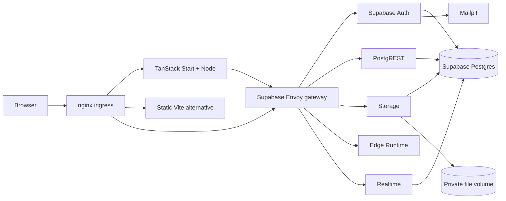

# Lovable → local Supabase scaffold

A standalone, local-first reference for running an exported Supabase-based app
without replacing its Auth, database API, Storage, Realtime, or Edge Function
interfaces. Includes **TanStack Start + Node SSR** and **React/Vite static** reference
frontends sharing the same demo, pinned official Supabase Docker services, local
email capture, RLS and private-file examples.

This is an example and migration foundation, **not an automatic Lovable converter**.
Lovable's FAQ identifies TanStack Start for new projects from May 13, 2026, and from
June 22, 2026 for Enterprise workspaces; older exports use React/Vite. New scaffold
instances default to TanStack. Existing instances without FRONTEND_KIND keep Vite.
Inspect the actual package.json when migrating an export.
[Verified stack details and sources](docs/LOVABLE_STACK.md).

## Run locally

If adapting an existing export, run preflight first and preserve its environment
files. Initialization refuses to change an existing `.env` that it did not generate.
Use a separate local env file/stack directory when integrating into an exported repo.

Requirements: Docker/Compose v2 (recent version supporting `config --format json`),
Python 3.11+, make; enough memory for Supabase (upstream recommends 8 GB+ for the
full stack). First start downloads large images and compiles the frontend.

```sh
make init        # TanStack default; unique local credentials; does not overwrite an existing .env
make up          # Start local services and apply versioned sample migrations
```

Open **http://localhost:8090**. Create an account with an `@example.test` email and
password of at least 8 characters. Open **http://localhost:18025**, open its captured
confirmation email, follow the confirmation link, then sign in. No email is sent
to an external mail provider. There is **no built-in demo/demo-password account**.

In TanStack mode, the initial HTML is rendered by Node. **Check server connection**
calls a real TanStack server function through the ingress using the internal backend
URL and anonymous role. An anonymous denial is the expected secure response.
User sessions in this demo are browser-managed; authenticated SSR is not implemented.

Create a note, run the analysis Edge Function, and upload/download a private file.
Open the app in a second tab to see Realtime updates. RLS restricts notes and
storage objects to their owner; these checks happen in Supabase, not just the UI.

```sh
make smoke       # Real signup/email, two-user RLS, files, function and logout checks
make check       # Validate all local Compose profiles
make logs        # Follow logs; inspect locally, don't paste credentials/token URLs
make down        # Stop only this stack; keep local data
make frontend KIND=tanstack  # Switch this instance to the Node/SSR adapter
make frontend KIND=vite     # Switch to the static adapter; preserves backend data
make admin       # Optional Studio + metadata services
```

After `make admin`, Studio is at http://localhost:19800. Credentials are generated
as `DASHBOARD_USERNAME` and `DASHBOARD_PASSWORD` in the ignored `.env`; inspect them
locally. Do not confuse Studio credentials with application user credentials.
The same loopback-only gateway port provides administrative API access even when
Studio is off. **Never tunnel port 19800 or Mailpit port 18025.**

This project defaults to Compose name `lovable-local` and localhost port 8090.
For a **fresh copy with no .env**, choose a name and three free host ports:

```sh
python3 scripts/stack.py init --name my-app --port 8094 --admin-port 19804 --mail-port 18029 --frontend tanstack
make up
```

This generates `PUBLIC_URL=http://localhost:8094`, isolated project-scoped volumes,
and dedicated credentials. Initial flags refuse to overwrite existing settings.
For an existing instance, edit `.env` deliberately. Changing `STACK_NAME` selects
another set of volumes; it does not rename or migrate existing data. Changing
`WEB_PORT` also requires updating `PUBLIC_URL`. New instances always default to
localhost; an OrbStack/tunnel address is an explicit later choice.

Do not use vendor scripts directly; use the Make targets so project files,
generated secrets and profiles stay in effect. The dashboard migration case study
is in [SSR migration lessons](docs/SSR_MIGRATION.md).

## Containers



TanStack mode adds a stateless Node app container behind nginx. Vite mode serves
the static app directly from nginx. Both share the same backend. The backend includes database, gateway, Auth, PostgREST, Storage, image proxy,
Realtime, Edge Runtime, Mailpit and web. Studio/metadata use the `admin` profile;
Supavisor is available in the upstream-derived `pooler` profile. Neither is needed
for browser data access. Redis, Keycloak, MinIO, workers and observability are not
added by default because the example does not require them. Add optional modules
when the imported app needs them; Supabase Auth is already the identity system.

## OrbStack and tunnels

For OrbStack's generated HTTPS address, configure the actual public origin:

```sh
make origin URL=https://web.lovable-local.orb.local
```

For ngrok/Funnel, expose **8090 only**, then configure its HTTPS origin:

```sh
ngrok http 8090
make origin URL=https://YOUR-STABLE-DEMO-HOST
```

This updates browser configuration, Auth's public URL, email verification paths,
site URL and redirect allowlist, then recreates affected containers. To return:

```sh
make origin URL=http://localhost:8090
```

Use the configured origin for account creation and confirmation links. Existing
messages retain their original URLs; request a new confirmation message if needed.
The browser app's backend address is deliberately configured, not inferred from
untrusted request headers. No tunnel starts automatically. `make smoke` is limited
to localhost/OrbStack domains; real internet demos need a separate deliberate test.

## Import a Lovable backend

Use [the backend export/import runbook](docs/BACKEND_IMPORT.md) for repository SQL,
manually saved SQL, Drizzle journals, Edge Functions/shared code, database archives,
table CSVs, downloaded storage files and job definitions. Collection never executes
SQL or functions. Artifacts stay in ignored, private `.imports/` bundles with checksums.

```sh
python3 scripts/backend.py import /path/to/export --name my-app
python3 scripts/backend.py inspect my-app
python3 scripts/backend.py migrate my-app --layout supabase   # plan only
```

Apply reviewed migrations with `--execute`; activate function/configuration mounts
separately. Use a fresh project/ports for an imported application. The bundled demo
UI/smoke tests depend on the sample schema and are not generic tests of an import.
Secrets/provider settings and connector accounts must be configured separately.

## How reuse works

- `vendor/supabase/`: official Docker distribution, unmodified and pinned; provenance
  and license in `vendor/UPSTREAM.md` and `vendor/SUPABASE-LICENSE`.
- `scripts/stack.py`: generates ignored, permission-restricted runtime Compose config
  and unique local credentials; adapts volumes, ports, names and optional profiles.
- `compose.yaml`: our frontend, SMTP capture, and sample function mount.
- `web/`: shared demo component and static Vite adapter with public-only config.
- `web-tanstack/`: SSR routes, server function, Node Dockerfile and nginx ingress.
- `compose.tanstack.yaml`: selected by FRONTEND_KIND; Node receives only public client
  config and an internal gateway URL, never database/service-role credentials.
- `supabase/migrations/`: versioned SQL with RLS and private storage policies.
- `supabase/functions/`: application functions mounted into the official runtime.
- `.runtime/` and `.env`: generated secrets/state; never commit or share them.

The local API uses legacy HS256 anon/service-role keys for compatibility with the
pinned official stack. Anon keys are public identifiers constrained by RLS; service
keys and signing secrets are privileged. Moving to asymmetric/opaque keys is a
separate reviewed upgrade using upstream tooling, not an untested checkbox.

Read [SSR migration lessons](docs/SSR_MIGRATION.md), [migration](docs/MIGRATION.md), [security](docs/SECURITY.md),
[hosting options](docs/CLOUD.md), and [validation](docs/VALIDATION.md).
